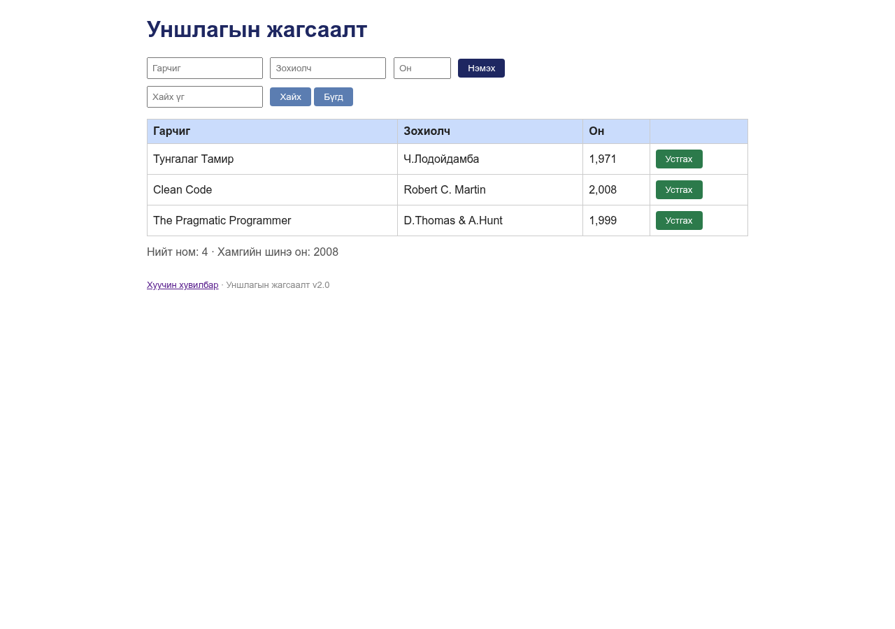

# BUG-01: Хүснэгтийн «Он» баганад он мянгатын таслалтай (1,971) харагддаг

Орчин:  Уншлагын жагсаалт v2.0, Brave 157.1.99.57 (Chromium; headless, DevTools Protocol-оор удирдсан), Ubuntu 26.04.1 LTS, 2026-11-19
Урьдчилсан нөхцөл: `node app.js`-ийг шинээр асаасан (анхны 3 ном), http://localhost:3000 нээсэн (цонхны өргөн 1280px)

## Дахин гаргах алхам

1. http://localhost:3000 хуудсыг нээ.
2. Хүснэгтийн «Он» баганыг хар.

Хүлээгдэж байсан: «Он нь 1000-2100 хоорондох бүхэл тоо; хүснэгтэд энгийн тоогоор (жишээ нь 1999) харагдана.»

Бодит үр дүн:     Он `1,971` · `2,008` · `1,999` гэж мянгатын таслалтай харагдана. Шинээр нэмсэн ном ч мөн адил (`1940` → `1,940`, BUG-10-ийн зураг). Харин доорх «Хамгийн шинэ он: 2008»-д таслалгүй — нэг хуудсанд хоёр өөр формат.

Ноцтой байдал: Minor — өгөгдөл зөв, зөвхөн харагдац буруу; он бол тоо хэмжигдэхүүн биш, тодорхойлогч тул таслал нь уншихад төөрөгдүүлнэ.

Хавсралт:      [`screenshots/bug-01.png`](../screenshots/bug-01.png)

Олдсон аялал:  Supermodel (нүүр хуудсыг анх харахад)

