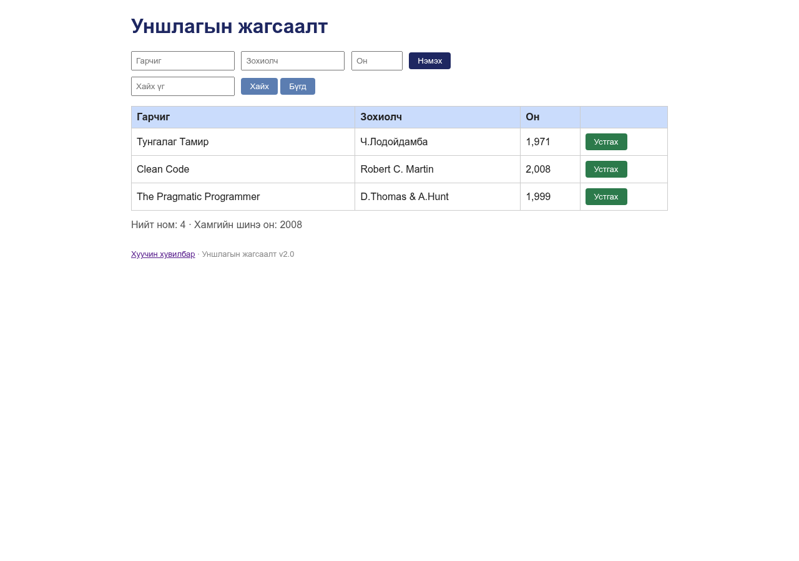

# BUG-02: «Нийт ном» тоолуур хүснэгтэд буй номын тооноос үргэлж 1-ээр их

Орчин:  Уншлагын жагсаалт v2.0, Brave 157.1.99.57 (Chromium; headless, DevTools Protocol-оор удирдсан), Ubuntu 26.04.1 LTS, 2026-11-19
Урьдчилсан нөхцөл: `node app.js`-ийг шинээр асаасан (анхны 3 ном), http://localhost:3000 нээсэн (цонхны өргөн 1280px)

## Дахин гаргах алхам

1. http://localhost:3000 хуудсыг нээ.
2. Хүснэгтийн мөрийг тоол — 3 ном.
3. Хүснэгтийн доорх «Нийт ном»-ыг хар.
4. (API-аар баталгаажуулах) `curl -i localhost:3000/api/books` — 3 бичлэг.

Хүлээгдэж байсан: «"Нийт ном" тоолуур хүснэгтэд буй номын тоотой тэнцүү.»

Бодит үр дүн:     3 номтой хүснэгтийн доор «Нийт ном: 4». API 3 бичлэг буцаадаг тул өгөгдөл зөв, тоолуур буруу. Session-ий үеэр нэмэх, устгах бүрийн дараа +1 зөрүү хэвээр байсан бөгөөд бүх номыг устгахад хоосон хүснэгттэй «Нийт ном: 1 · Хамгийн шинэ он: 0» гарсан (`screenshots/session/s11-empty-counter.png`).

Ноцтой байдал: Minor — өгөгдөл алдагдахгүй, гэхдээ анхны ачаалалтаас эхлэн хуудас бүр дээр буруу тоо харагдана.

Хавсралт:      [`screenshots/bug-02.png`](../screenshots/bug-02.png) · [`evidence/bug-02-curl.txt`](../evidence/bug-02-curl.txt)

Олдсон аялал:  Fed-Ex (тоолуурыг хүснэгт, API-тай тулгахад)

