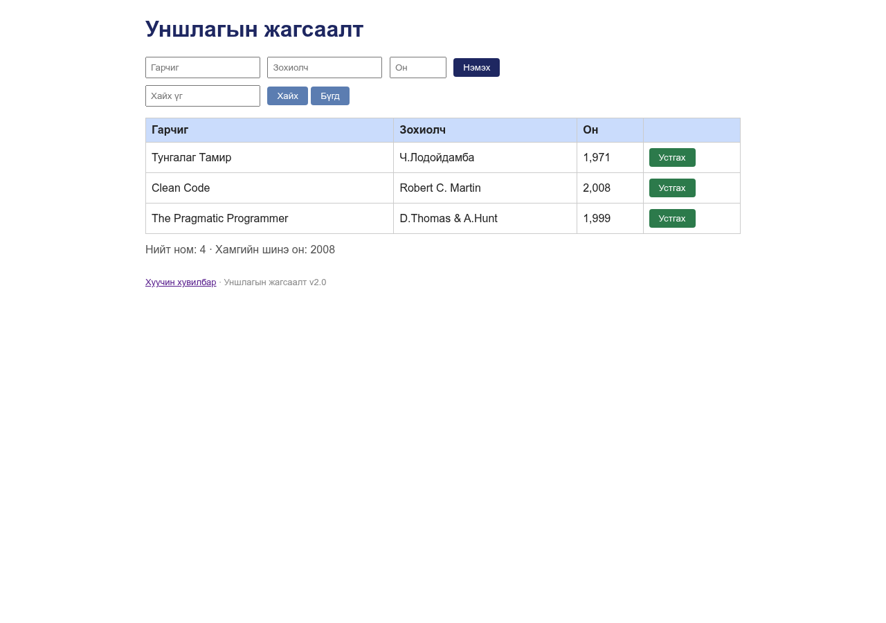

# BUG-03: Аюултай үйлдлийн «Устгах» товч улаан биш, ногоон өнгөтэй

Орчин:  Уншлагын жагсаалт v2.0, Brave 157.1.99.57 (Chromium; headless, DevTools Protocol-оор удирдсан), Ubuntu 26.04.1 LTS, 2026-11-19
Урьдчилсан нөхцөл: `node app.js`-ийг шинээр асаасан (анхны 3 ном), http://localhost:3000 нээсэн (цонхны өргөн 1280px)

## Дахин гаргах алхам

1. http://localhost:3000 хуудсыг нээ.
2. Хүснэгтийн мөр бүрийн баруун талын «Устгах» товчийн өнгийг хар.

Хүлээгдэж байсан: «Аюултай үйлдлийн товч (Устгах) улаан өнгөтэй.»

Бодит үр дүн:     Гурван «Устгах» товч бүгд ногоон (тооцоолсон `background-color: rgb(44, 122, 75)`). Ногоон өнгө ихэвчлэн «зөвшөөрөх / амжилт»-ыг илэрхийлдэг тул хэрэглэгч устгах үйлдлийг аюулгүй гэж ойлгож болно. Дарахад баталгаажуулах асуултгүй шууд устгадаг (BUG-08-ыг үз).

Ноцтой байдал: Minor — функц ажилладаг, гэхдээ аюулын харааны дохио буруу.

Хавсралт:      [`screenshots/bug-03.png`](../screenshots/bug-03.png)

Олдсон аялал:  Supermodel

