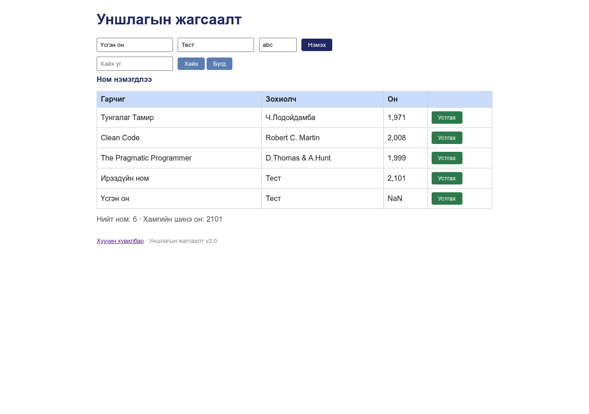

# BUG-05: Он 1000-2100 хязгаар, бүхэл тоо эсэхийг шалгадаггүй — 2101, «abc» (NaN) хүлээн авдаг

Орчин:  Уншлагын жагсаалт v2.0, Brave 157.1.99.57 (Chromium; headless, DevTools Protocol-оор удирдсан), Ubuntu 26.04.1 LTS, 2026-11-19
Урьдчилсан нөхцөл: `node app.js`-ийг шинээр асаасан (анхны 3 ном), http://localhost:3000 нээсэн (цонхны өргөн 1280px)

## Дахин гаргах алхам

1. http://localhost:3000 хуудсыг нээ.
2. Гарчиг `Ирээдүйн ном`, Зохиолч `Тест`, Он `2101` бичээд «Нэмэx» дар.
3. Гарчиг `Үсгэн он`, Зохиолч `Тест`, Он `abc` бичээд «Нэмэx» дар.

Хүлээгдэж байсан: «Он нь 1000-2100 хоорондох бүхэл тоо» — хоёр оролт хоёулаа татгалзагдаж, алдааны мессеж гарна.

Бодит үр дүн:     Хоёулаа «Ном нэмэгдлээ»; хүснэгтэд `2,101` ба `NaN` гэж харагдана, «Хамгийн шинэ он: 2101» болж өөрчлөгдөнө. Session-д `999`, `1999.5`, `-5`, `2000abc` (→ NaN), ` 2000 `, `0x7D0`, `2e3` (→ 2,000) бүгд хүлээн авагдсан; API-д `"year":"мянга"` мөн 201.

Ноцтой байдал: Major — буруу он өгөгдөлд орж, статистикийг («Хамгийн шинэ он») гажуудуулна.

Хавсралт:      [`screenshots/bug-05.png`](../screenshots/bug-05.png)

Олдсон аялал:  Couch Potato (Он-ы зааг утгууд)

