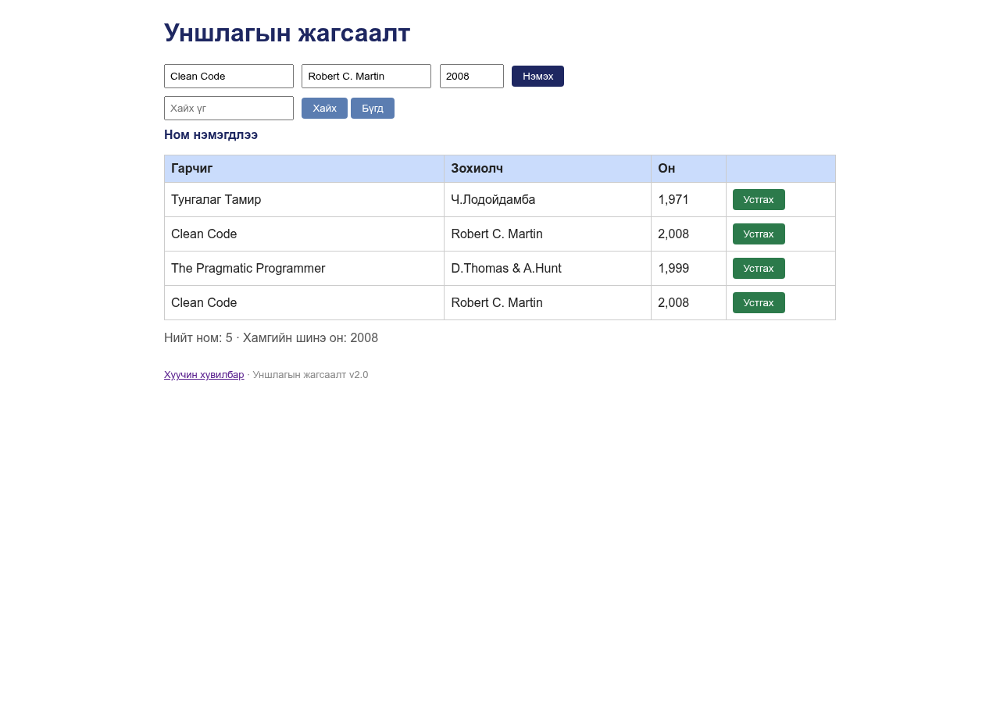

# BUG-06: Ижил гарчиг, зохиолчтой ном давхардаж нэмэгддэг

Орчин:  Уншлагын жагсаалт v2.0, Brave 157.1.99.57 (Chromium; headless, DevTools Protocol-оор удирдсан), Ubuntu 26.04.1 LTS, 2026-11-19
Урьдчилсан нөхцөл: `node app.js`-ийг шинээр асаасан (анхны 3 ном), http://localhost:3000 нээсэн (цонхны өргөн 1280px)

## Дахин гаргах алхам

1. http://localhost:3000 хуудсыг нээ (жагсаалтад «Clean Code / Robert C. Martin» аль хэдийн бий).
2. Гарчиг `Clean Code`, Зохиолч `Robert C. Martin`, Он `2008` бичээд «Нэмэx» дар.

Хүлээгдэж байсан: «Ижил гарчиг, зохиолчтой ном давхардуулж нэмэгдэхгүй.»

Бодит үр дүн:     «Ном нэмэгдлээ» мессеж гарч, хүснэгтэд «Clean Code / Robert C. Martin / 2,008» хоёр мөр болно. Session-д «Нэмэx»-ийг хоёр удаа хурдан дарахад ч 2 бичлэг үүссэн; нэмсний дараа талбарууд цэвэрлэгддэггүй тул санамсаргүй давхардал гарахад хялбар.

Ноцтой байдал: Major — өгөгдлийн бүрэн бүтэн байдлын дүрэм хэрэгждэггүй.

Хавсралт:      [`screenshots/bug-06.png`](../screenshots/bug-06.png)

Олдсон аялал:  Fed-Ex

