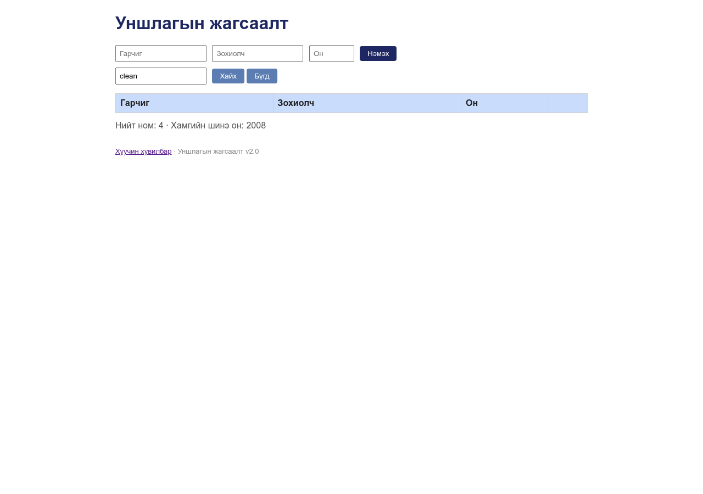

# BUG-07: Хайлт том/жижиг үсэг ялгадаг — «clean» гэж хайхад «Clean Code» олдохгүй

Орчин:  Уншлагын жагсаалт v2.0, Brave 157.1.99.57 (Chromium; headless, DevTools Protocol-оор удирдсан), Ubuntu 26.04.1 LTS, 2026-11-19
Урьдчилсан нөхцөл: `node app.js`-ийг шинээр асаасан (анхны 3 ном), http://localhost:3000 нээсэн (цонхны өргөн 1280px)

## Дахин гаргах алхам

1. http://localhost:3000 хуудсыг нээ.
2. «Хайх үг» талбарт `Clean` бичээд «Хайх» дар — 1 мөр (Clean Code) гарна.
3. Талбарыг `clean` болгоод «Хайх» дар.

Хүлээгдэж байсан: «Хайлт гарчиг болон зохиолчоос хайх ба том/жижиг үсэг ЯЛГАХГҮЙ.» — `clean` гэж хайхад Clean Code гарна.

Бодит үр дүн:     Хүснэгт хоосон (0 мөр), «олдсонгүй» гэх мессеж ч гарахгүй. Session-д `CLEAN` → 0; зохиолчоор `martin` → 0 (`Martin` → 1+); кирилл `лодойдамба` → 0 (`Лодойдамба` → 1).

Ноцтой байдал: Major — хэрэглэгч ихэвчлэн жижиг үсгээр хайдаг тул хайлтын гол функц ихэнх тохиолдолд ажиллахгүй.

Хавсралт:      [`screenshots/bug-07.png`](../screenshots/bug-07.png)

Олдсон аялал:  Fed-Ex

