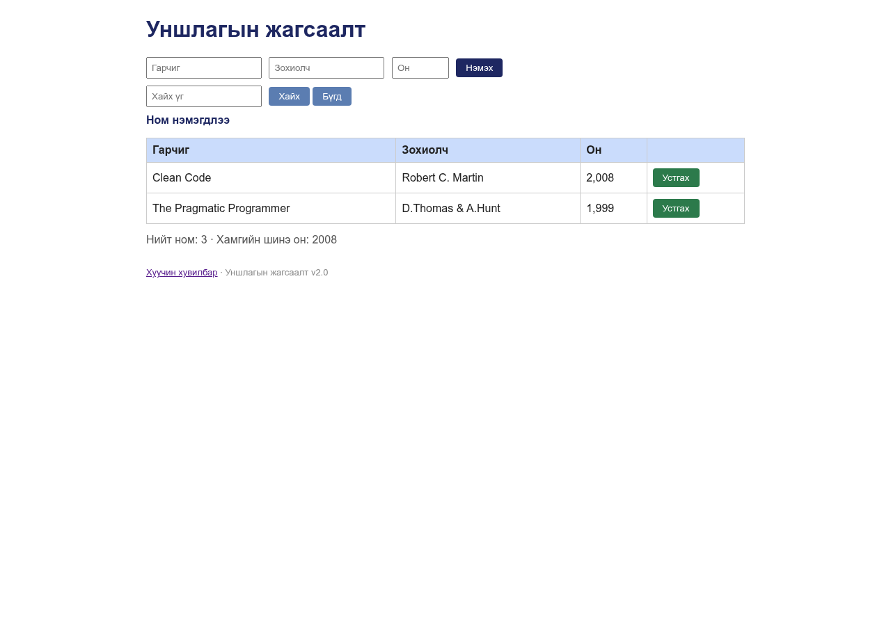

# BUG-08: Ном устгасны дараа «Ном нэмэгдлээ» гэсэн буруу мессеж гардаг

Орчин:  Уншлагын жагсаалт v2.0, Brave 157.1.99.57 (Chromium; headless, DevTools Protocol-оор удирдсан), Ubuntu 26.04.1 LTS, 2026-11-19
Урьдчилсан нөхцөл: `node app.js`-ийг шинээр асаасан (анхны 3 ном), http://localhost:3000 нээсэн (цонхны өргөн 1280px)

## Дахин гаргах алхам

1. http://localhost:3000 хуудсыг нээ (мессежийн мөр хоосон).
2. «Тунгалаг Тамир» мөрийн «Устгах» товч дээр дар.

Хүлээгдэж байсан: «Үйлдэл бүрийн дараах мессеж тухайн үйлдэлдээ тохирно» — жишээ нь «Ном устгагдлаа».

Бодит үр дүн:     Ном устгагдана (хүснэгтэд 2 мөр үлдэнэ), гэвч мессеж «Ном нэмэгдлээ». Баталгаажуулах асуултгүй шууд устгадаг.

Ноцтой байдал: Minor — хэрэглэгчийг төөрөгдүүлнэ: устгах үйлдэл амжилттай болсныг мессежээр мэдэх боломжгүй.

Хавсралт:      [`screenshots/bug-08.png`](../screenshots/bug-08.png)

Олдсон аялал:  Fed-Ex

