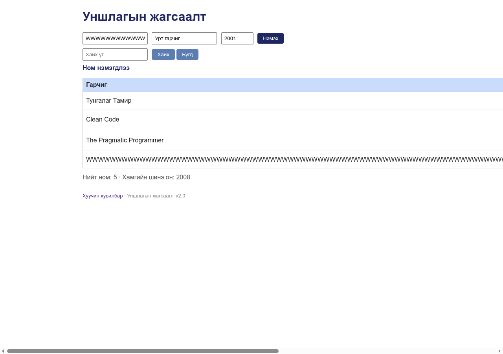

# BUG-09: Зайгүй урт гарчигтай ном нэмэхэд хүснэгт дэлгэцээс халиж Зохиолч, Он, «Устгах» харагдахгүй болдог

Орчин:  Уншлагын жагсаалт v2.0, Brave 157.1.99.57 (Chromium; headless, DevTools Protocol-оор удирдсан), Ubuntu 26.04.1 LTS, 2026-11-19
Урьдчилсан нөхцөл: `node app.js`-ийг шинээр асаасан (анхны 3 ном), http://localhost:3000 нээсэн (цонхны өргөн 1280px)

## Дахин гаргах алхам

1. http://localhost:3000 хуудсыг 1280px өргөн цонхонд нээ.
2. Гарчиг талбарт доорх 120 тэмдэгтийг хуулж буулга, Зохиолч `Урт гарчиг`, Он `2001` бичээд «Нэмэx» дар.
3. Хүснэгтийг хар.

```
WWWWWWWWWWWWWWWWWWWWWWWWWWWWWWWWWWWWWWWWWWWWWWWWWWWWWWWWWWWWWWWWWWWWWWWWWWWWWWWWWWWWWWWWWWWWWWWWWWWWWWWWWWWWWWWWWWWWWWWW
```

Хүлээгдэж байсан: «Хүснэгт ямар ч урттай оролтод эвдрэхгүй» — урт текст мөр шилжих эсвэл таслагдах ёстой.

Бодит үр дүн:     Хүснэгт 2096px өргөн болж 1280px цонхноос халина; БҮХ мөрийн Зохиолч, Он багана ба «Устгах» товч баруун тийш гарч харагдахгүй (хэвтээ гүйлгэх шаардлагатай). Session-д 300 тэмдэгтэд хүснэгт 4533px болсон. API-д урт хязгаар алга — 200 000 тэмдэгтийн гарчиг `201 Created`.

Ноцтой байдал: Minor — нэг урт оруулга бүх хэрэглэгчийн хүснэгтийг эвдэж, устгах товчийг нуудаг.

Хавсралт:      [`screenshots/bug-09.png`](../screenshots/bug-09.png)

Олдсон аялал:  Supermodel


