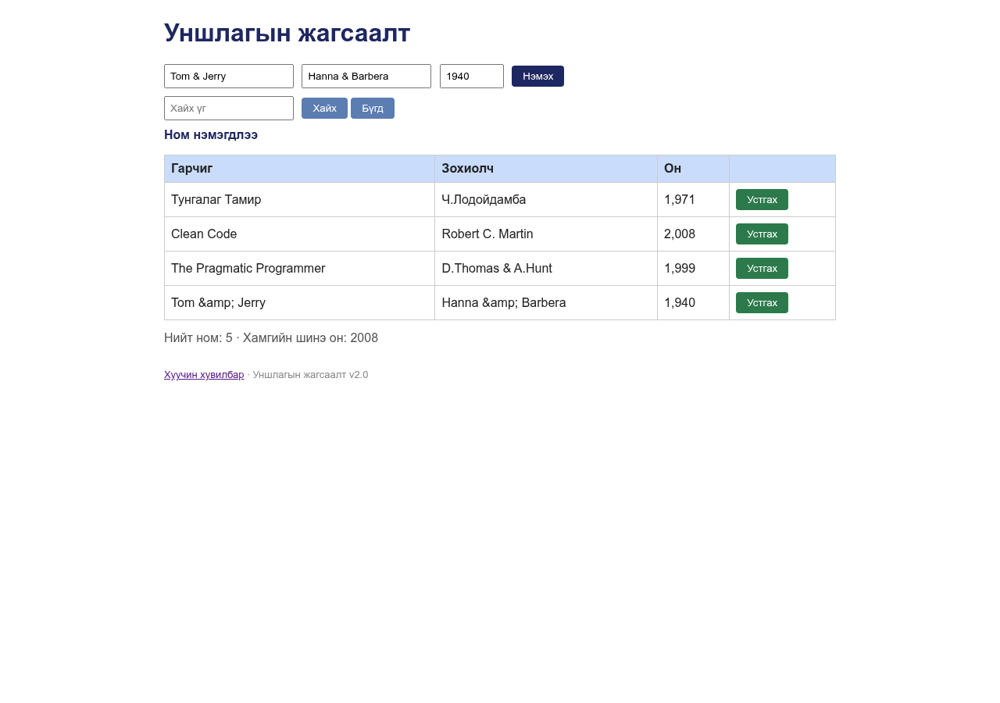

# BUG-10: «&» агуулсан ном хадгалахдаа HTML entity болж хувирдаг (`Tom & Jerry` → `Tom &amp; Jerry`)

Орчин:  Уншлагын жагсаалт v2.0, Brave 157.1.99.57 (Chromium; headless, DevTools Protocol-оор удирдсан), Ubuntu 26.04.1 LTS, 2026-11-19
Урьдчилсан нөхцөл: `node app.js`-ийг шинээр асаасан (анхны 3 ном), http://localhost:3000 нээсэн (цонхны өргөн 1280px)

## Дахин гаргах алхам

1. http://localhost:3000 хуудсыг нээ.
2. Гарчиг `Tom & Jerry`, Зохиолч `Hanna & Barbera`, Он `1940` бичээд «Нэмэx» дар.
3. Хүснэгтийн шинэ мөрийг хар.
4. (API) `curl -i localhost:3000/api/books`

Хүлээгдэж байсан: Оруулсан текст өөрчлөгдөлгүй хадгалагдаж харагдана (эрүүл ухаан) — анхны «D.Thomas & A.Hunt» шиг `&` хэвээр.

Бодит үр дүн:     Хүснэгтэд `Tom &amp; Jerry`, `Hanna &amp; Barbera` гэж харагдана. API ч `"title":"Tom &amp; Jerry"` гэж буцаадаг — өгөгдөл бичих үедээ эвдэрдэг (давхар escape), зөвхөн харагдацын асуудал биш. Session-д `<b>Тод</b>` гарчиг хүснэгтэд `&lt;b&gt;Тод&lt;/b&gt;` болж харагдсан (XSS ажиллаагүй — сайн тал). Шинэ номын `year` нь `"1940"` string, анхны 3 номынх тоо (`1971`).

Ноцтой байдал: Major — өгөгдөл хадгалах түвшинд гэмтдэг тул API-аар уншдаг бусад систем ч буруу утга авна.

Хавсралт:      [`screenshots/bug-10.png`](../screenshots/bug-10.png) · [`evidence/bug-10-curl.txt`](../evidence/bug-10-curl.txt)

Олдсон аялал:  Supermodel (тусгай тэмдэгт) → API-аар баталгаажуулсан (Saboteur)

