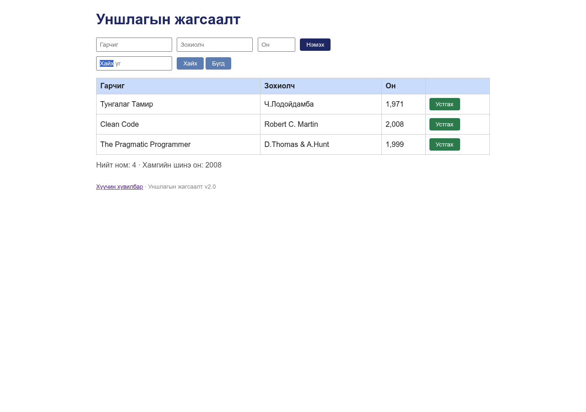

# BUG-14: «Нэмэx» товчны сүүлийн үсэг кирилл «х» биш латин «x»

Орчин:  Уншлагын жагсаалт v2.0, Brave 157.1.99.57 (Chromium; headless, DevTools Protocol-оор удирдсан), Ubuntu 26.04.1 LTS, 2026-11-19
Урьдчилсан нөхцөл: `node app.js`-ийг шинээр асаасан (анхны 3 ном), http://localhost:3000 нээсэн (цонхны өргөн 1280px)

## Дахин гаргах алхам

1. http://localhost:3000 хуудсыг нээ.
2. Ctrl+F дарж `Нэмэх` (кирилл «х»-тэй) гэж хайх — хуудсанд олдохгүй; `Хайх` гэж хайхад олдоно.
3. (Байтаар баталгаажуулах) `curl -s localhost:3000/ | grep -o 'Нэмэ.' | od -An -tx1`

Хүлээгдэж байсан: «Текстүүд үсгийн алдаагүй» — «Нэмэх» (сүүлийн үсэг кирилл х, U+0445, UTF-8 `d1 85`).

Бодит үр дүн:     Товчны текст «Нэмэx» — сүүлийн тэмдэгт латин x (U+0078, байт `78`). Нүдэнд ижил харагдах ч хуудсаас «Нэмэх» гэж хайхад олдохгүй, «Нэмэх» текстээр товч хайдаг автомат тест (Playwright `getByText`) мөн олохгүй.

Ноцтой байдал: Cosmetic — харагдац ижил; гэхдээ хайлт ба автоматжуулалтад нөлөөтэй.

Хавсралт:      [`screenshots/bug-14.png`](../screenshots/bug-14.png) · [`evidence/bug-14-bytes.txt`](../evidence/bug-14-bytes.txt)

Олдсон аялал:  Supermodel

